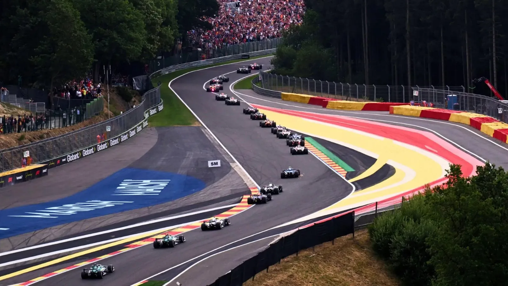

<p align="center">
  
</p>

<h1 align="center">TodoF1</h1>

<p align="center">
  <strong>Estadísticas, clasificaciones y fichas históricas de Fórmula 1.</strong><br>
  Un proyecto de portfolio centrado en datos, rendimiento y experiencia de uso.
</p>

<p align="center">
  <a href="https://todof1.alwaysdata.net/"><strong>Ver producción</strong></a>
  ·
  <a href="https://portfolio-dzs.vercel.app/proyectos/todof1"><strong>Ver en el portfolio</strong></a>
  ·
  <a href="https://github.com/Daniel-Zarco/TodoF1"><strong>Código</strong></a>
  ·
  <a href="https://github.com/Daniel-Zarco"><strong>GitHub</strong></a>
</p>

<p align="center">
  <a href="https://github.com/Daniel-Zarco/TodoF1/actions/workflows/deploy.yml">
    
  </a>
</p>

---

## Sobre el proyecto

TodoF1 es una web de consulta de Fórmula 1 construida para explorar la temporada actual y también el archivo histórico. Reúne calendario, pilotos, escuderías, circuitos, clasificaciones y estadísticas en una interfaz oscura, adaptable y con identidad visual por equipo.

El sitio público no requiere cuenta ni autenticación. Los datos deportivos se obtienen de **Jolpica** y se sirven a través de un proxy propio con caché persistente, pensado para mantener la web disponible cuando la API externa falla o limita peticiones.

**Versión:** `1.0.0`

## Funcionalidades

### Inicio

- Panel con la temporada activa, próxima carrera y clasificaciones de pilotos y constructores.
- Indicadores de grandes premios, pilotos, escuderías y resultados.
- Imagen de portada, créditos fotográficos y selector de temporada.
- Temas visuales inspirados en las escuderías.

### Pilotos

- Listado por temporada con posición, puntos, escudería, dorsal y código.
- Búsqueda por nombre, filtro por escudería y ordenación por campeonato, nombre o dorsal.
- Fichas individuales con trayectoria, resultados por temporada, equipos, gráficos y fotografía.
- Fotografías de Wikipedia con imagen de respaldo cuando no hay fotografía disponible.

### Escuderías

- Listado por temporada con puntos, victorias, podios, grandes premios y pilotos.
- Búsqueda y ordenación por campeonato, nombre, victorias o puntos.
- Fotografías de monoplazas, logotipos históricos y respaldos tipográficos.
- Fichas con identidad de equipo, evolución histórica, palmarés, pilotos y estadísticas.

### Circuitos

- Calendario por temporada con estado de cada Gran Premio.
- Búsqueda, filtro por país y ordenación por ronda o nombre.
- Trazados de circuitos y fichas con ganadores, resultados, vuelta rápida y horarios.
- Navegación entre temporadas actuales e históricas.

### Estadísticas

- Resumen de la temporada con indicadores, gráficos de puntos, victorias y podios.
- Tablas de clasificación de pilotos y constructores.
- Evolución de puntos por Gran Premio.
- Comparador de dos pilotos de la misma temporada.

### Experiencia

- Diseño adaptable con panel de búsqueda y filtros plegable en móvil.
- Selector de temporada persistente durante la sesión del navegador.
- Carga diferida de imágenes y estados de carga, vacío y error.
- Sin inicio de sesión ni sesiones en la web pública.

## Tecnologías

| Capa | Tecnología |
|---|---|
| Servidor | PHP 8.2+ |
| Interfaz | HTML5, CSS3 y JavaScript vanilla |
| Datos | API de Jolpica (compatible con Ergast) |
| Caché | Archivos JSON en disco, gestionados por PHP |
| Servidor web | Apache en Alwaysdata |
| Despliegue | GitHub Actions + SSH + rsync |

La web pública se sirve directamente como PHP, sin compilación de interfaz ni framework de JavaScript. No necesita Composer ni npm para funcionar.

## Arquitectura de datos

```text
Navegador
   │
   ├── index.html/Page*.php       Páginas y fichas
   ├── index.html/js/*            Lógica de interfaz y filtros
   │
   └── petición a la API ──► /api/f1.php?ruta=...
                              │
                              ├── Lista blanca de rutas y parámetros
                              ├── Caché persistente en private/f1-cache
                              ├── Peticiones únicas compartidas y cortacircuitos
                              └── Jolpica: api.jolpi.ca/ergast/f1
```

`api/f1.php` actúa como proxy y respaldo. Guarda respuestas válidas en disco, aplica tiempos de vida distintos según la temporada y evita peticiones duplicadas. Si la API externa no responde, sirve la última copia válida; si no existe, devuelve un error controlado.

Las páginas públicas no dependen de una base de datos. La información deportiva se obtiene en tiempo de ejecución y las imágenes se sirven desde `Images/`.

## Despliegue

El despliegue está automatizado con GitHub Actions:

1. Envío a `main`.
2. Ejecución del flujo de trabajo `Deploy TodoF1`.
3. Pruebas del sistema de retención de copias de seguridad.
4. Conexión SSH al servidor de Alwaysdata.
5. Publicación selectiva de `index.html`, `Images`, los puntos de acceso permitidos de `api` y los archivos de raíz.
6. Verificación de direcciones reales de producción.
7. Retención de las copias de seguridad más recientes.

La raíz del sitio mantiene redirección HTTP a HTTPS y `.user.ini` evita que los errores PHP se muestren al visitante, manteniendo el registro en el servidor.

## Ejecución local

Requisitos:

- PHP 8.2 o superior con extensión cURL.

No hace falta instalar Composer ni npm para probar la web pública.

```bash
git clone https://github.com/Daniel-Zarco/TodoF1.git
cd TodoF1
php -S 127.0.0.1:8000 -t .
```

Abre:

```text
http://127.0.0.1:8000/index.html/PagePrincipal.php
```

El servidor embebido de PHP no procesa `.htaccess`; por eso se usa directamente la ruta de la página principal. La caché de la API se crea en `private/f1-cache` o en una carpeta temporal si no hay permisos de escritura.

## Estructura

```text
index.html/        Páginas PHP, estilos, scripts e imágenes de interfaz
api/               Proxy de datos y utilidades internas
Images/            Fotografías, logotipos, trazados y recursos visuales
deploy/            Scripts de despliegue, copias de seguridad y archivos de raíz
.github/workflows/ Flujos de trabajo de despliegue y mantenimiento
```

## Créditos

Las fotografías de monoplazas, retratos, logotipos y trazados conservan los créditos y licencias indicados en la propia web. TodoF1 es un proyecto personal de Daniel Zarco.

- [GitHub](https://github.com/Daniel-Zarco)
- [Portfolio](https://portfolio-dzs.vercel.app/)
- [TodoF1 en producción](https://todof1.alwaysdata.net/)
